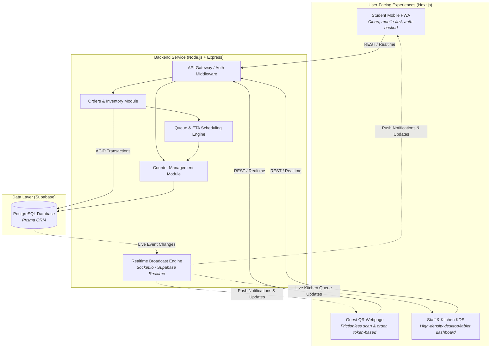
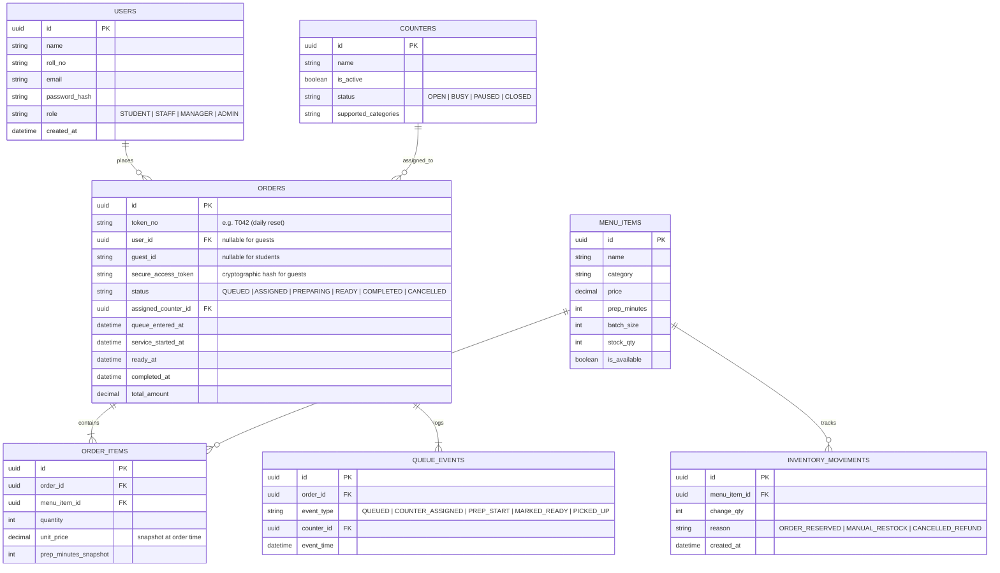

# Smart Canteen — Complete Technical Architecture & Overview

> **Single Connected System** · Three User Experiences · One Shared Modular Backend · Dynamic Queue & ETA Engine

---

## 1. Executive Summary & Vision

The **Smart Canteen** system is designed to eliminate long physical waiting queues, provide predictive real-time ETAs, optimize kitchen order flow across multiple service counters, and prevent stock discrepancies.

Instead of fragmenting the solution into disparate apps, this architecture uses a **Modular Monolith** structure:
- **One Next.js Web Frontend** serving three tailored responsive experiences (Student PWA, Guest QR Page, Staff/Kitchen Dashboard).
- **One Node.js + Express Backend API** hosting business logic, database transactions, and an integrated JavaScript Queue/ETA Scheduling Engine.
- **One Managed PostgreSQL Database (via Supabase)** with Prisma ORM ensuring ACID-compliant order placement, concurrency-safe inventory reservations, and live synchronization.



---

## 2. Core User-Facing Experiences

### A. Student Application (Mobile-First PWA)
- **Target Audience:** Enrolled students with university credentials.
- **Form Factor:** Progressive Web App (PWA) installable on Android/iOS without app store friction.
- **Theme & Aesthetics:** Warm, modern, minimal. Off-white background, deep navy typography, vibrant orange ordering accents, and green status indicators. Bottom navigation bar.
- **Key Features:**
  - Fast authenticated browsing with categorization and search.
  - Live item prep times, real-time counter crowd indicators, and cart builder.
  - Token tracking (`T042`), real-time counter assignment, countdown timer, and order history.

### B. Guest QR Webpage (Frictionless Web Access)
- **Target Audience:** Campus visitors, parents, workshop attendees, guest faculty.
- **Form Factor:** Instant web page opened via physical table/canteen QR scan (`/guest/[canteenSlug]`).
- **Theme & Aesthetics:** Identical clean brand identity, stripped of account barriers.
- **Key Features:**
  - No mandatory registration; temporary session identity generated on first load.
  - Streamlined cart submission.
  - Cryptographically secure, unguessable tracking URL (`/track/[token]?secret=...`) preventing token enumeration attacks.

### C. Canteen Management & Kitchen Display System (KDS)
- **Target Audience:** Canteen staff, kitchen cooks, canteen managers.
- **Form Factor:** Desktop/tablet responsive dashboard with high-contrast information density and optional dark kitchen mode.
- **Theme & Aesthetics:** Clear status badges, audible alerts, tabular and kanban board views. Desktop sidebar navigation.
- **Key Features:**
  - Live order queue organized by preparation stages.
  - Multi-counter workload balancing: view pending queue depth per counter.
  - Quick action controls: `Start Preparation`, `Mark Ready`, `Complete`, `Item Sold Out`.
  - Analytics: peak throughput, average turnaround time, counter bottleneck detection.

---

## 3. Technology Stack & Rationale

| Layer | Technology | Selection Rationale |
| :--- | :--- | :--- |
| **Frontend Framework** | **Next.js + React + TypeScript** | Unified codebase for Student, Guest, and Staff portals using route groups and file-based routing. |
| **UI & Styling** | **Tailwind CSS + shadcn/ui** | Rapid, accessible, component-driven UI with consistent tokens across mobile PWA and desktop dashboard. |
| **Backend API** | **Node.js + Express + TypeScript** | High-performance modular monolith with strict typing, clean separation of concerns, and easy integration. |
| **Queue / Scheduling Engine** | **JavaScript / TypeScript Engine** | Dynamic load-balancing heuristics, batching calculations, and ETA predictions run within the backend service. |
| **Database** | **PostgreSQL (via Supabase)** | Relational integrity, foreign keys, row-level locking (`SELECT FOR UPDATE`), and transactional consistency. |
| **ORM & Migrations** | **Prisma ORM** | Type-safe database queries, schema-as-code (`schema.prisma`), and declarative database migrations. |
| **Live Updates** | **Socket.IO or Supabase Realtime** | Immediate status propagation (e.g. `PREPARING` ➔ `READY`) without client polling. |
| **Validation** | **Zod** | Shared contract validation across frontend form handling and backend payload validation. |
| **Testing** | **Vitest + Supertest** | Lightning-fast unit tests for queue logic and integration testing for API endpoints. |
| **Deployment** | **Vercel + Render + Supabase** | Front-end on Vercel edge/CDN, API on Render Node container, DB on Supabase cloud. |

---

## 4. Application Routing Architecture

A single Next.js project handles student, guest, staff, and admin routing:

| Route | Purpose | Access Control |
| :--- | :--- | :--- |
| `/` | Landing page & mobile portal home | Public |
| `/login` | Student login / authentication | Public |
| `/menu` | Interactive canteen menu and ordering | Public / Authenticated Student |
| `/track/[token]` | Live visual tracker for an order | Valid unguessable token or order owner |
| `/history` | Historical orders & receipts | Authenticated Student |
| `/guest/[canteenSlug]` | Direct QR entry point for visitors | Public (generates guest session) |
| `/staff/login` | Staff / Admin credential login | Public |
| `/staff/dashboard` | Live Kitchen Queue & Counter Monitor | Role: `STAFF` or `MANAGER` |
| `/staff/menu` | Item availability & stock management | Role: `STAFF` or `MANAGER` |
| `/staff/analytics` | Wait-time statistics & efficiency logs | Role: `MANAGER` or `ADMIN` |
| `/admin` | System-wide configuration & counter setup | Role: `ADMIN` |

---

## 5. Database Schema & Data Integrity

The database uses PostgreSQL via Prisma. Key models and schema constraints:



### Critical Concurrency & Database Rules
1. **Atomic Stock Decrement:** Stock availability is checked and decremented inside an isolation transaction (`SELECT FOR UPDATE`). If an item is down to 1 stock and two users place orders simultaneously, one order succeeds and the other receives an out-of-stock notification.
2. **Dynamic Counter Concurrency:** Orders are assigned to counters using transactional workload balancing to avoid overwhelming a single counter.
3. **Immutable Price Snapshots:** `ORDER_ITEMS.unit_price` preserves the price charged at the transaction moment regardless of future menu adjustments.
4. **Daily Token Scoping:** Tokens (e.g. `T001` - `T999`) reset every service day and are indexed uniquely per `(canteen_id, service_day, token_no)`.
5. **No Synthetic ETAs in Database:** Actual timestamps (`queue_entered_at`, `service_started_at`, `ready_at`) represent the ground truth; current ETAs are dynamically computed by the queue engine based on active counter throughput.

---

## 6. Order State Machine & API Endpoints

### Order Lifecycle
```
[QUEUED] ──(Engine Assignment)──> [ASSIGNED] ──(Staff Starts)──> [PREPARING] ──(Staff Finishes)──> [READY] ──(Customer Collects)──> [COMPLETED]
   │                                  │
   └──(Cancelled before prep)─────────┴──────────────────────────────────────────────────────────────────────────────> [CANCELLED]
```

### Core API Contracts
- `POST /api/auth/login`: Student or staff JWT authentication.
- `GET /api/menu`: Live available menu items and active prep time estimates.
- `POST /api/orders`: Validate payload (Zod), verify & deduct stock in transaction, allocate queue token.
- `GET /api/orders/:id/track`: Poll/fetch tracking metadata (verified via user session or guest token).
- `GET /api/staff/queue`: Fetch live queue partitioned by status and counter.
- `POST /api/staff/orders/:id/start`: Transition order status from `ASSIGNED` ➔ `PREPARING`.
- `POST /api/staff/orders/:id/ready`: Transition order status from `PREPARING` ➔ `READY` and trigger push alert.
- `POST /api/staff/orders/:id/complete`: Transition order status from `READY` ➔ `COMPLETED`.
- `PATCH /api/staff/menu/:id`: Real-time stock adjustment or availability toggle.
- `GET /api/staff/analytics`: Real-time operational metrics (wait times, order volume, bottle-necks).

---

## 7. Monorepo Repository Structure

```text
smart-canteen/
├── apps/
│   ├── web/                     # Next.js 14+ App Router frontend
│   │   ├── app/
│   │   │   ├── (student)/       # Student screens (Home, Menu, Cart, History)
│   │   │   ├── guest/           # Guest QR scan landing & ordering
│   │   │   ├── track/           # Live order tracking page
│   │   │   ├── staff/           # Staff dashboard, KDS & stock controls
│   │   │   ├── admin/           # Administrative configuration
│   │   │   ├── login/           # Authentication portal
│   │   │   └── layout.tsx       # Root layout & providers
│   │   ├── components/          # Reusable shadcn/ui & custom components
│   │   ├── features/            # Feature-sliced modules (menu, cart, queue, etc.)
│   │   ├── lib/                 # Client utilities & API client
│   │   └── public/              # Icons, PWA manifest, static assets
│   │
│   └── api/                     # Node.js + Express backend
│       ├── src/
│       │   ├── config/          # Environment & database configs
│       │   ├── middleware/      # Auth, rate-limiting & error middleware
│       │   ├── modules/
│       │   │   ├── auth/        # JWT / session handlers
│       │   │   ├── menu/        # Menu retrieval & management
│       │   │   ├── orders/      # Order creation & transactional mutations
│       │   │   ├── queue/       # Queue scheduling orchestrator
│       │   │   ├── counters/    # Counter status & workload tracking
│       │   │   ├── inventory/   # Stock movements & reservation logic
│       │   │   └── analytics/   # Wait-time & throughput metrics
│       │   ├── engine/          # Standalone JS queue & ETA computation engine
│       │   ├── realtime/        # WebSockets / event broadcaster
│       │   ├── utils/           # Logger, validators, response formatters
│       │   ├── app.ts           # Express app setup
│       │   └── server.ts        # Server entrypoint
│       └── prisma/
│           ├── schema.prisma    # Prisma PostgreSQL schema
│           ├── migrations/      # Versioned SQL migrations
│           └── seed.ts          # Mock menu, counter, and user seed data
│
├── packages/
│   └── shared/                  # Shared TypeScript library
│       ├── types/               # Order, Menu, User, Counter interfaces
│       ├── validation/          # Zod validation schemas
│       └── constants/           # Status codes, role definitions, config constants
│
├── docs/                        # Architecture, database & API documentation
│   ├── architecture.md
│   ├── database.md
│   └── api.md
│
├── .env.example                 # Template for required environment variables
├── package.json                 # Monorepo workspace configuration (pnpm/npm/turbo)
└── SMART_CANTEEN_OVERVIEW.md    # This master document
```

---

## 8. Status Checklist & Future Actions Roadmap

### 📋 Stage 1: Foundation & Infrastructure (Next Immediate Step)
- [ ] Initialize monorepo workspace configuration (`npm` workspaces or `pnpm` + Turbo).
- [ ] Scaffold `apps/web` (Next.js with TypeScript, Tailwind CSS, Lucide icons, shadcn/ui).
- [ ] Scaffold `apps/api` (Express with TypeScript, ESLint, CORS, dotenv).
- [ ] Scaffold `packages/shared` for shared TypeScript types and Zod schemas.
- [ ] Configure PostgreSQL database connection on Supabase.
- [ ] Write initial `prisma/schema.prisma` with `User`, `MenuItem`, `Counter`, `Order`, `OrderItem`, and `QueueEvent` tables.
- [ ] Run initial Prisma migration and create `prisma/seed.ts` with test menu items, counters, and admin accounts.
- [ ] Implement JWT / session authentication with role-based guard middleware (`student`, `staff`, `admin`).

### 📋 Stage 2: Core Menu, Cart & Transactional Ordering
- [ ] Implement Menu retrieval API (`GET /api/menu`) with category filtering.
- [ ] Build mobile-first responsive Student menu & item modal in `apps/web`.
- [ ] Implement client-side persistent Cart state (React context / Zustand).
- [ ] Build transactional Order placement API (`POST /api/orders`):
  - [ ] Enforce Zod validation.
  - [ ] Execute atomic inventory reservation inside PostgreSQL transaction (`SELECT FOR UPDATE`).
  - [ ] Generate daily sequential token (e.g. `T001`).
  - [ ] Store price snapshots in `OrderItem`.
- [ ] Implement Guest QR scan entrypoint (`/guest/[canteenSlug]`) with cryptographic tracking tokens.

### 📋 Stage 3: Queue & ETA Engine Integration
- [ ] Integrate existing JavaScript/TypeScript scheduling engine into `apps/api/src/engine/`.
- [ ] Implement multi-counter routing algorithms:
  - Match item categories to counter capabilities.
  - Dynamic workload distribution based on active order backlog.
- [ ] Calculate live ETA predictions based on prep times, batch size, and counter queue depth.
- [ ] Implement `/track/[token]` live order progress tracking page for customers.

### 📋 Stage 4: Staff Kitchen Display System (KDS) & Realtime Synchronization
- [ ] Build Staff desktop dashboard (`/staff/dashboard`) with split views:
  - Active Queue (Orders awaiting preparation).
  - Counter Workload view (Active items per counter).
  - Ready for Pickup tray.
- [ ] Implement Kitchen action endpoints:
  - `POST /api/staff/orders/:id/start` (marks `PREPARING`).
  - `POST /api/staff/orders/:id/ready` (marks `READY`).
  - `POST /api/staff/orders/:id/complete` (marks `COMPLETED`).
- [ ] Wire up real-time bidirectional communication (Socket.IO or Supabase Realtime):
  - Broadcast status changes immediately to customer tracking screens.
  - Broadcast new incoming orders to KDS without page refresh.
  - Include auto-reconnect fallback with latest state sync.

### 📋 Stage 5: Testing, Peak Simulation & Cloud Deployment
- [ ] Write unit & integration tests using Vitest + Supertest for:
  - Double-booking / concurrent last-item order attempts.
  - Invalid order state machine transitions.
  - Token daily reset logic.
- [ ] Run peak-hour stress simulation script (simulating 100+ concurrent orders across 3 counters).
- [ ] Prepare deployment configurations:
  - Deploy Next.js Web App to **Vercel**.
  - Deploy Express API to **Render** with health checks.
  - Link production Supabase PostgreSQL instance.
- [ ] Configure production environment variables, CORS policies, and HTTPS URLs.
- [ ] Generate physical and printable QR codes for testing on mobile devices.

### 📋 Stage 6: Future Expansion (Post-Core Launch)
- [ ] Payment gateway integration (UPI / Razorpay / Stripe or campus card RFID integration).
- [ ] Bill splitting among students.
- [ ] Automated SMS / WhatsApp pickup notifications.
- [ ] Loyalty badges, reward discounts, and student leaderboards.
- [ ] Advanced predictive kitchen restocking forecasts using historical rush-hour data.

---

## 9. Next Immediate Actions to Start Development

1. **Initialize Project Scaffolding:** Set up the monorepo root, create `apps/web`, `apps/api`, and `packages/shared`.
2. **Setup Database & Prisma:** Define the PostgreSQL schema in Prisma, connect Supabase, and seed demo menu items.
3. **Connect API & Frontend:** Create the first end-to-end flow from menu display to order submission.
